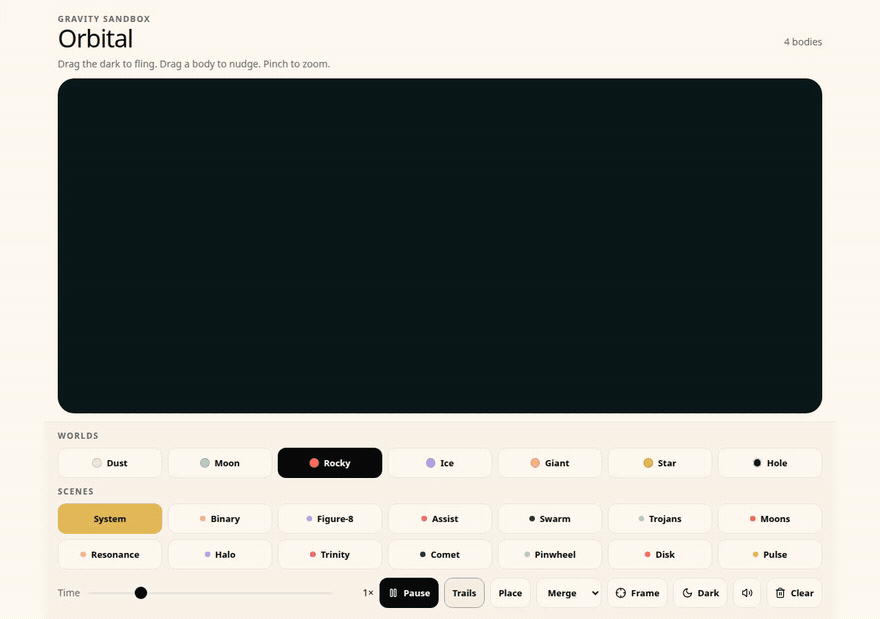

# Orbital



An n-body gravity sandbox where you fling planets and watch orbits, slingshots, and collisions.

Live demo: [orbital-livid-five.vercel.app](https://orbital-livid-five.vercel.app)

## Run

```bash
npm install && npm run dev
```

Open [http://localhost:8080](http://localhost:8080).

## Play

- Drag empty space to fling a new body. Drag a body to nudge it.
- Pick a mass, from dust up to a black hole.
- Load a scene: System, Binary, Figure-8, Assist, Swarm, and more.
- Switch collisions between merge, bounce, and pass-through.
- Trails, time scale, pause, frame, and a light or dark dock.

## Contributing

See [CONTRIBUTING.md](CONTRIBUTING.md). Orbital is [MIT licensed](LICENSE).
